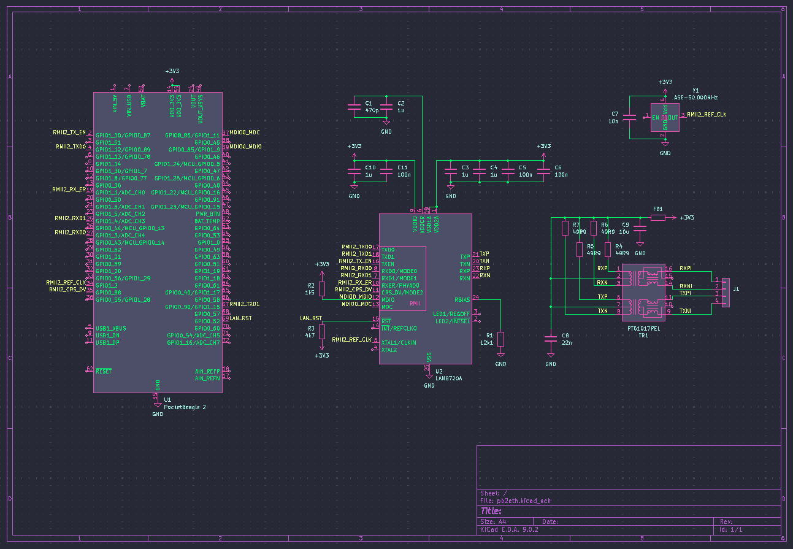
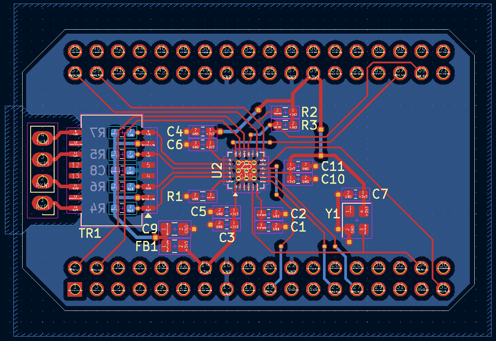
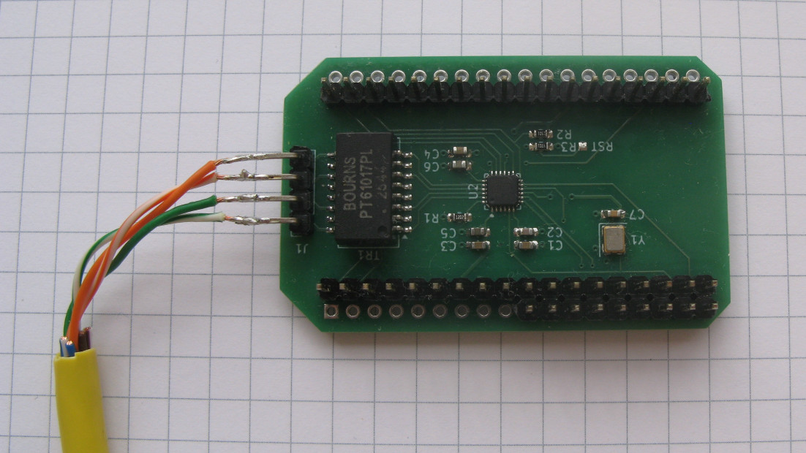

### PocketBeagle 2 ethernet cape

Unlike the original PocketBeagle, PocketBeagle 2 exposes RMII signals on its expansion headers, so a native ethernet cape (not USB or SPI) is now possible.





When plugging the cape onto PB2, make sure the PB2 USB-C connector is on the same side as the ethernet transformer.

To enable the cape, you have to compile and enable its DeviceTree overlay (dtso).

Your PB2 system image should come with sources for the preinstalled overlays in /opt/source/dtb-(kernel_version)/src/arm64/overlays/
including the machinery to compile and install them. I'm using kernel 6.18.x so the following example is based on that.
```
cp pb2-lan8720.dtso /opt/source/dtb-6.18.x/src/arm64/overlays/
cd /opt/source/dtb-6.18.x
./build_n_install.sh
```
If everything went ok, all overlays, including the new pb2-lan8720.dtbo should be installed to /boot/firmware/overlays
All that's left to do is to tell the kernel to use the overlay and that's done with the fdtoverlays option in /boot/firmware/extlinux/extlinux.conf
The label that typically boots by default is MicroSD (default), so just add (or uncomment) the fdtoverlays option and add the overlay.
```
label microSD (default)
    kernel /Image.gz
    append console=ttyS2,115200n8 earlycon=ns16550a,mmio32,0x02860000 .....
    fdtdir /
    fdtoverlays /overlays/pb2-lan8720.dtbo
    #initrd /initrd.img
```
Note that the overlay disables spi0 because it shares its SPI0_CS0 pin P2.31 with RMII2_TXD1. You can still use spi0 with SPI0_CS1 (P2.36).
I've included pb2-spi0-cs1.dtso if you want to do that, just remember to remove the spi0 disable block from pb2-lan8720.dtso as well.

